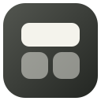
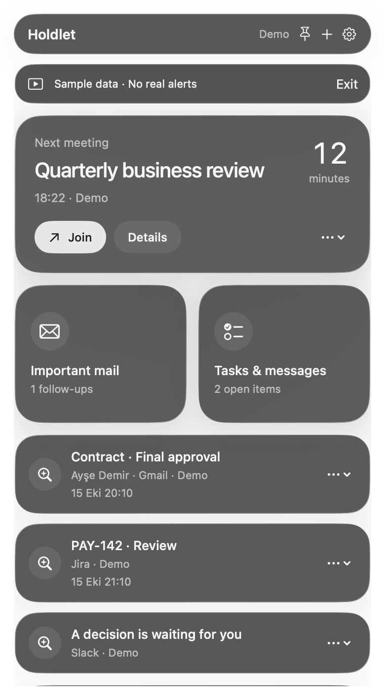

<p align="center"></p>
<h1 align="center">Holdlet</h1>
<p align="center">Keep work from slipping away.</p>
<p align="center">A native, open-source macOS menu-bar companion for meetings, follow-ups and focused work.</p>
<p align="center"><a href="https://github.com/lemkyz/holdlet/actions/workflows/ci.yml">Build & tests</a> · <a href="docs/SETUP.md">Connect your tools</a> · <a href="docs/ROADMAP.md">Roadmap</a> · <a href="docs/README.tr.md">Türkçe</a></p>

**Status: developer alpha.** Mac Calendar and local workflows have been exercised in the app. Google, Slack and Jira need developer setup and have not passed live-account acceptance. A green test run does not mean those connections are ready for ordinary users. No shared Google OAuth application is configured in the default download. See [connection readiness](docs/STATUS.md).

<p align="center"></p>

The screenshot is from the running native app with synthetic data. Window-only captures may flatten desktop translucency.

## What it does

- Lives in the menu bar; can launch at login with your permission.
- Opens a Control Center-inspired panel with native glass modules. Uses Liquid Glass on macOS 26, visual-effect materials on macOS 14-15.
- Shows the next meeting with a countdown and a safe HTTPS join link.
- Keeps personal follow-up states separate from source-system task states: active, waiting, snoozed, complete.
- Saves local reminders, snoozes and focus sessions across restarts.
- Watches marked Gmail threads for new incoming messages on successful sync; reading a message does not complete its follow-up.
- Includes a 25-minute focus timer, manual screen-sharing privacy mode, connection health, and a sample-data mode.
- Supports English and Turkish UI. Provider error details may be English.

## Connections in this alpha

| Source | Supported scope | Setup |
|---|---|---|
| Mac Calendar | Selected calendars, next 7 days, timed/non-declined events | macOS Calendar permission |
| Google Calendar | Primary calendar, next 7 days, up to 250 timed events | Import Desktop OAuth JSON or use a publisher-configured build |
| Gmail | Up to 50 matching threads, plus up to 50 waiting threads | Same Google sign-in; works alongside Mac Calendar |
| Slack | Up to 100 matches for a user-defined search | Internal user OAuth token with `search:read` |
| Jira Cloud | Up to 100 unfinished issues assigned to you | Site, account email, unscoped personal API token |

Sync runs every 3 minutes while the Mac is awake. This is **not push delivery**. Over-limit responses produce a visible error and preserve the previous snapshot. Slack is a personal/internal setup, not a Marketplace-approved public integration. Jira 3LO, multi-account connections, automatic Slack reply detection, all-day events, and phones are not supported yet. See [setup and limitations](docs/SETUP.md).

## Build and run

Runs on macOS 14+. Building requires Swift 6+ and the macOS 26 SDK (Xcode 26+ or matching Command Line Tools) for the availability-gated Liquid Glass API. The current code was locally built with Swift 6.3.3 on Apple Silicon. CI uses a full Xcode toolchain. No third-party Swift dependencies.

```bash
git clone https://github.com/lemkyz/holdlet.git
cd holdlet
./scripts/test.sh
./scripts/build-app.sh
open dist/Holdlet.app
```

For a credential-free, isolated demo:

```bash
open -n dist/Holdlet.app --args --demo --show
```

Demo fixture items never schedule notifications. The isolated `--demo` process does not poll connected services or persist its sample state. Close it before launching the normal app. Do not run `swift run Holdlet` for Calendar/notification testing: use the `.app` bundle so macOS can find usage descriptions and app identity.

The build script signs locally with an **ad-hoc signature** unless `SIGNING_IDENTITY` is provided. An ad-hoc signature is not Developer ID signing or Apple notarization. Build from source for now. A downloadable alpha, if attached to a release, has the same limitation; do not disable Gatekeeper globally. For distribution, see [release instructions](docs/RELEASING.md).

## First run

1. Try sample data or create a local reminder using **+**.
2. Open **Settings → General**, allow notifications, and send the five-second test.
3. Enable **Launch at login** if desired. Install the app in a stable location before enabling it.
4. Connect Mac Calendar, or configure Google/Slack/Jira using [the setup guide](docs/SETUP.md).
5. Set work hours and meeting lead time. Work hours currently apply every day in this Mac's time zone.

Click the pin to keep the panel visible when clicking elsewhere. Escape hides it. Closing Settings keeps Holdlet running; **Quit Holdlet** exits. Joining opens the link, and does not prove you actually attended a call.

## Privacy and reliability

- Credentials are stored in macOS Keychain, not in the repository or local state file.
- Follow-ups, headers/titles, connection status and preferences are saved locally in `~/Library/Application Support/Holdlet/state-v1.json`, with directory mode `0700` and file mode `0600`.
- That file is **not encrypted by Holdlet**. FileVault is a system setting.
- Network requests go to explicitly connected providers. Google OAuth uses the system browser, PKCE/state and a temporary IPv4 loopback listener. No mail bodies are fetched for the current UI.
- No telemetry, ads, hidden AI calls, automatic sending, Jira updates, or notification-center scraping.
- Disconnect removes a provider's local items and local credentials, and reconciles pending reminders. Provider-side token revocation is separate.
- Focus, notification permission, sleep and system policies affect delivery. The app cannot promise an alert while the Mac is powered off. It reconciles on wake and surfaces overdue local work.

See [architecture](docs/ARCHITECTURE.md), [validation](docs/VALIDATION.md), and [security policy](SECURITY.md).

## Contribute

Useful first contributions: provider fixtures, keyboard accessibility, time-zone edge cases, translations, and clean-machine install testing. Please read [CONTRIBUTING.md](CONTRIBUTING.md) before starting a new connector. Do not attach real emails, messages, tokens, or customer data to issues.

Created by [Melike Polat](https://github.com/lemkyz). Licensed under [Apache-2.0](LICENSE).
